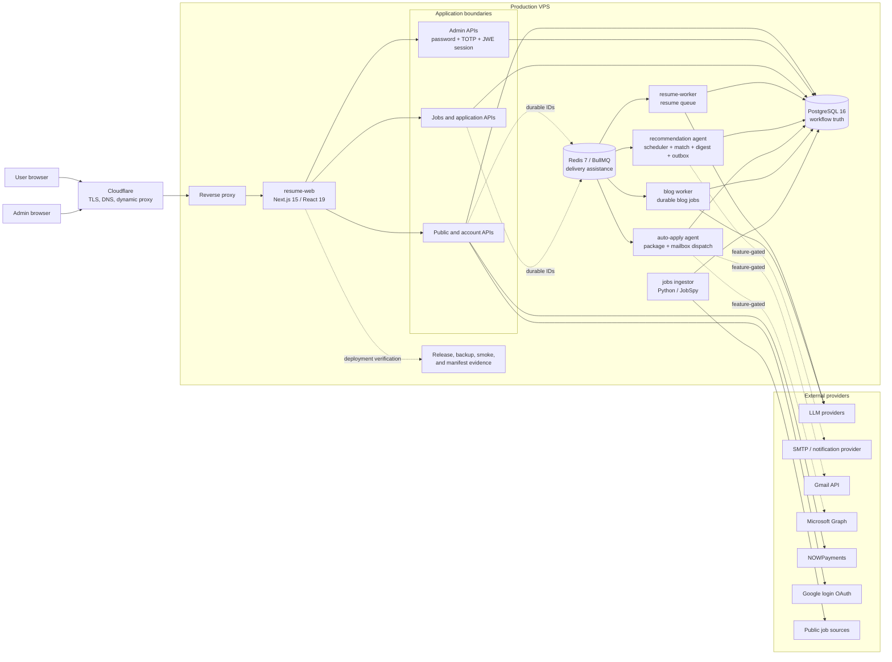
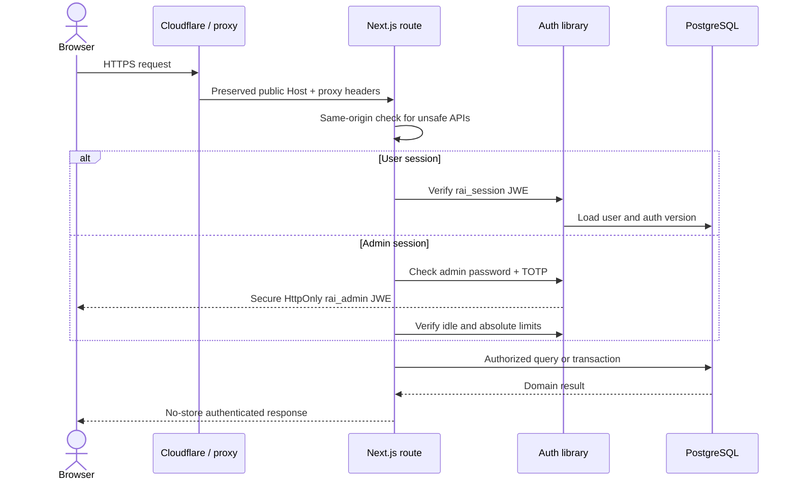
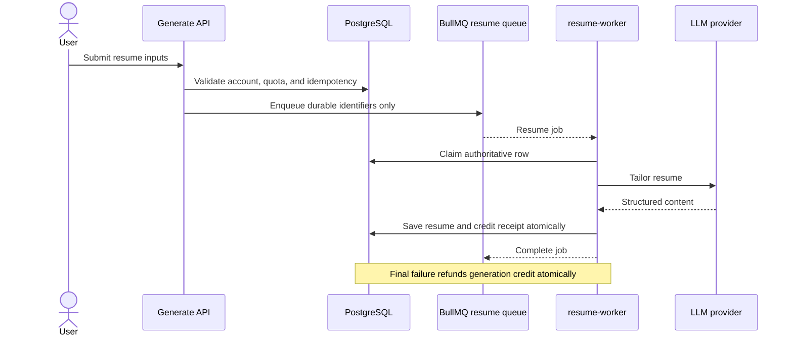
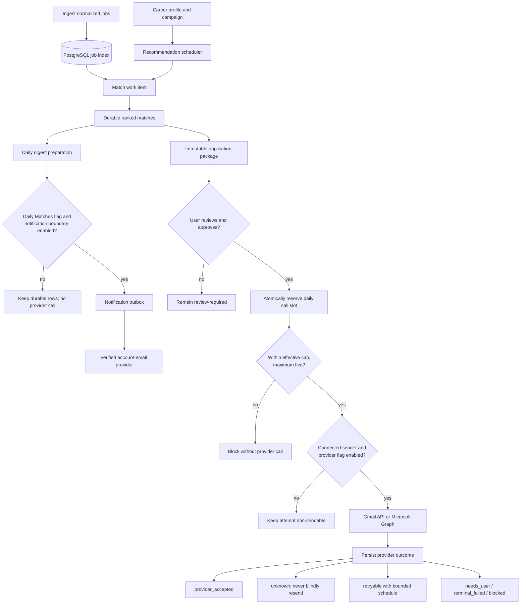

# RoleSharp system architecture

> Production safety boundary: deploying workflow code does not authorize outbound automation. `JOBS_WORKFLOWS_ENABLED`, Gmail sending, Microsoft sending, and the four persisted Jobs feature flags remain disabled until a separately approved canary.

RoleSharp is a Next.js application with PostgreSQL-authoritative business workflows, Redis/BullMQ delivery queues, six hardened systemd services, and Cloudflare in front of the VPS. Durable database rows—not queue messages—are the source of truth for quotas, leases, approvals, retries, and provider receipts.

## Read the system map

## Runtime services and ownership

| Service | Entry point | Owns | Durable authority | Stop behavior |
|---|---|---|---|---|
| `resume-web` | `npm run start` | Pages, API routes, auth, admin UI | PostgreSQL and encrypted cookies | 30-second systemd stop timeout |
| `resume-worker` | `worker/index.ts` | `resume` queue and generated-resume persistence | PostgreSQL generation rows and credit receipts | Closes worker and Redis connection |
| `rolesharp-jobs` | `scripts/job_ingestor.py` | Country-aware job ingestion | PostgreSQL job index and ingestion runs | `SIGINT`, interruptible polling, 45-second timeout |
| `rolesharp-recommendation-agent` | `worker/recommendation-agent.ts` | Scheduler, `jobs-match`, `jobs-digest`, `notification-outbox` | PostgreSQL work items, digests, outbox, leases | 75-second drain inside 90-second systemd timeout |
| `rolesharp-auto-apply-agent` | `worker/auto-apply-agent.ts` | `application-package`, `mailbox-dispatch` | PostgreSQL packages, approvals, attempts, quota receipts | 75-second drain inside 90-second systemd timeout |
| `rolesharp-blog-worker` | `worker/blog-generation.ts` | Durable administrative blog generation | PostgreSQL blog-generation jobs | Up to five-minute drain inside 330-second timeout |

The old scheduler, match, mail, and outbox units are superseded and must remain disabled.

## Trust and authentication boundaries

User and admin authentication are separate. Sessions are encrypted JWE tokens using direct-key `A256GCM`; passwords are hashed with `scrypt`. Admin login additionally requires TOTP, has an eight-hour absolute limit, and uses a configurable idle timeout. Unsafe API mutations require a same-origin browser request, resolved against the externally visible host preserved by the proxy.

## Resume generation flow

Queue payloads must not contain resume text or other unnecessary personal data. Account deletion cancels or sanitizes queued work and removes user-owned rows transactionally.

## Jobs recommendation and application flow

PostgreSQL enforces the daily employer-email provider-call cap. The effective cap is the lowest applicable user/admin policy and can never exceed five. Packages are immutable, every send requires explicit user review, and only source-backed auto-eligible recipients can cross the provider boundary.

Durable work claims use 90-second leases and 30-second heartbeats. Completion or failure requires the current live lease. A provider call that may have crossed the boundary but lacks a proven response is classified `unknown` and is never automatically resent.

## Data authority

| Data class | Authoritative store | Important invariants |
|---|---|---|
| Users, auth version, entitlements, credits | PostgreSQL | Transactional mutations and idempotent receipts |
| Resumes and exports | PostgreSQL plus generated response bytes | User ownership; deletion cascades into packages |
| Jobs and matching | PostgreSQL | Normalized identity and durable match decisions |
| Campaigns, packages, approvals, attempts | PostgreSQL | Review-each authorization; immutable package content |
| Quotas and provider receipts | PostgreSQL | Maximum five calls/day; final-slot race protected |
| Workflow leases and retries | PostgreSQL | Live owner required; bounded retries; unknown is terminal for automatic sending |
| Queue delivery | Redis/BullMQ | Durable IDs and schema version only; safe to reconcile from PostgreSQL |
| Deployment evidence | `/opt/resume-ai/data` | Backup, source manifest, schema digest, smoke result, release verification |

## Deployment and production topology

```mermaid
flowchart LR
  source[Local source snapshot] --> transfer[rsync with secret, data,\nbuild, evidence exclusions]
  transfer --> release[Timestamped release directory]
  release --> build[Install and isolated Next.js build]
  build --> backup[Verified PostgreSQL custom dump]
  backup --> migrations[Replay migrations twice]
  migrations --> verify[Source/schema verification]
  verify --> smoke[Disposable fake-provider smoke]
  smoke --> activate[Atomic current symlink switch]
  activate --> services[Enable/restart six services]
  services --> health[Origin and public health checks]
  health --> cloudflare[Cloudflare purge/parity checks]
  activate -. failure .-> rollback[Restore previous release]
```

Production lives under `/opt/resume-ai`:

- `releases/<release-id>` contains immutable timestamped releases.
- `current` atomically points at the active release.
- `current-release` records the active release ID.
- `.env` remains outside releases and is never transferred from the workstation.
- `data/deploy-evidence/<release-id>` stores release verification.
- `data/backups` stores verified database backups.

`deploy.sh` builds before migrations, creates a pre-migration backup, proves migration idempotency, records the base Git commit and exact dirty-tree source-manifest digest, runs isolated smoke checks, and activates only after verification. It automatically restores the previous release if activation or health checks fail.

## Operational safety checklist

1. Inspect PostgreSQL before Redis when diagnosing workflows.
2. Never manually reset `unknown`, `provider_accepted`, or terminal attempts to sendable states.
3. Keep all environment and persisted Jobs/provider flags off during deployment verification.
4. Use only the isolated smoke runner for fake transports; production fake settings fail closed.
5. Stop recommendation scheduling before application workers during an incident, then allow the configured drain.
6. Preserve hashes, timestamps, invocation ordinals, flag snapshots, and release/schema identities; never place tokens, recipients, bodies, or resume bytes in tickets.
7. Verify the active source-manifest digest rather than relying only on the base Git commit when the deployed tree contains intentional uncommitted work.

## Authoritative references

- [Jobs workflow setup](JOBS-WORKFLOWS-SETUP.md)
- [Jobs operations runbook](JOBS-WORKFLOWS-RUNBOOK.md)
- [Jobs rollback](JOBS-WORKFLOWS-ROLLBACK.md)
- [Google mailbox verification](GOOGLE-MAILBOX-VERIFICATION.md)
- [Microsoft mailbox registration](MICROSOFT-MAILBOX-REGISTRATION.md)
- [VPS hardening runbook](../deploy/VPS-HARDENING-RUNBOOK.md)
- [Security policy](../SECURITY.md)
- [Design system](../DESIGN.md)
